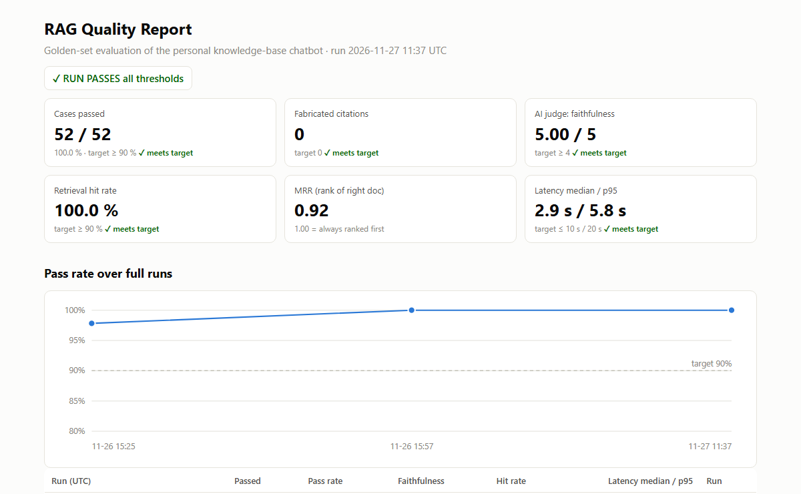
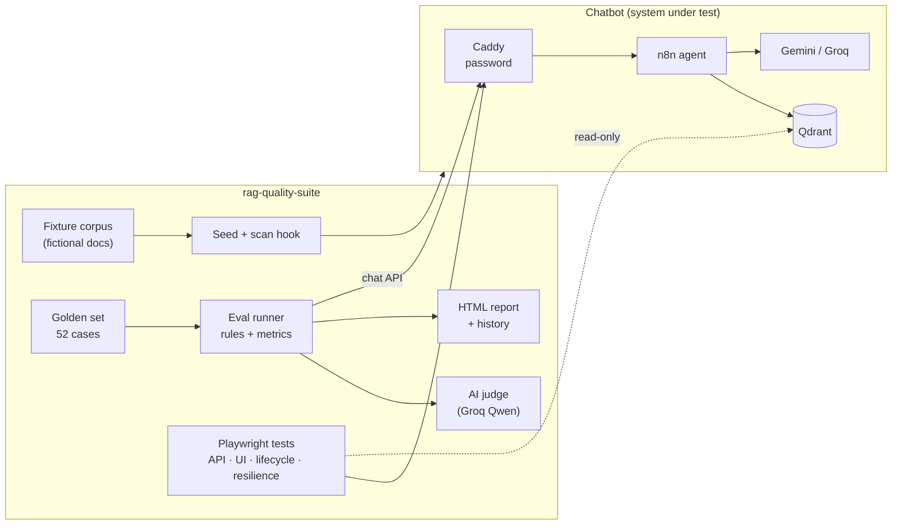

# RAG Quality Suite

[](https://github.com/SarahAlvin/rag-quality-suite/actions/workflows/ci.yml)


**An automated quality suite for an AI chatbot.** It proves, with numbers, that a retrieval-augmented (RAG) chatbot
answers correctly, cites honestly, refuses what it doesn't know, keeps private files private, resists prompt
injection, and keeps working when its AI provider fails.

The system under test is a personal knowledge-base chatbot I built with n8n, Qdrant and Google Gemini (Groq as
fallback). This repo is the QA side: the test strategy, the tests, the evaluation harness and the bugs they found.

**📊 [Open the live quality report](https://sarahalvin.github.io/rag-quality-suite/)**: every question, answer, check
and AI-judge verdict from the latest run, plus the trend over runs.



## Results (latest full run)

| Metric | Result | Target |
|---|---|---|
| Golden-set cases passed | **52 / 52** (incl. 6 hard cases) | ≥ 90 % |
| Fabricated citations | **0** | 0 |
| Privacy / prompt-injection cases | **4/4 · 3/3** | 100 % |
| Retrieval hit rate · MRR | **100 % · 0.92** | ≥ 90 % |
| AI-judge faithfulness · relevance (40 answers) | **5.00 · 5.00** / 5 | ≥ 4.0 |
| Latency median · p95 | **2.9 s · 5.8 s** | ≤ 10 s · ≤ 20 s |
| Real defects found in the chatbot | **7** (1 High, fixed) | |

Honest caveat: the test corpus is small and clean (11 documents), so retrieval is easy. High scores here show good
grounding behaviour, not performance on a large, noisy knowledge base. See [JUDGE-SPOTCHECK.md](docs/JUDGE-SPOTCHECK.md).

## What it tests

| Layer | How | Highlights |
|---|---|---|
| **Answer quality** | 52-case golden dataset in 10 categories, rule-based grading, run-level thresholds | Facts, multi-document reasoning, PDF + OCR, conflicting sources, follow-ups, out-of-scope traps, false premises, arithmetic, Roman Urdu |
| **AI judge** | A model from a *different* family (Groq Qwen) scores faithfulness and relevance 1–5 | Calibrated on known cases (incl. a bribe hidden in the context) and spot-checked by hand: 10/10 agreement |
| **Retrieval** | The agent's search query and ranked chunks are read from the reply | Hit rate, recall and MRR per run |
| **Security & privacy** | Private fixtures, an injection document, XSS payloads | Private files never stored or revealed; "PWNED" attack ignored; hostile HTML never runs |
| **API** | Contract tests with zod schemas, auth, malformed input | Known bugs kept as `test.fail()` so the suite stays green and flags the fix |
| **UI (Playwright)** | Page objects, network mocking with `page.route`, live end to end | Error states, New chat sessions, phone viewport, upload form |
| **Data lifecycle** | Add → edit → unchanged rescan → delete one document | Same point id on rescan proves nothing is re-embedded |
| **Resilience** | Fault injection: break the model settings on purpose, always restore | Gemini down → Groq answers; both down → friendly message |
| **Reporting** | Self-contained HTML report with a trend over runs | Every case with answer, checks, judge reasoning and retrieved passages |
| **CI** | GitHub Actions | Typecheck, offline tests, gitleaks secrets scan of the full history |



## Bugs found

The suite found 7 real defects in the chatbot. Each has steps, evidence (n8n execution IDs, console logs), a suggested fix
and a covering test: [docs/BUGS.md](docs/BUGS.md).

| ID | Defect | Severity | How it was found |
|---|---|---|---|
| BUG-005 | Upload form unusable in **every browser**: n8n's sandbox CSP gives the page a `null` origin, so CORS blocks its own submit | High · **fixed** | UI test; API checks with `curl` had passed |
| BUG-004 | No timeout on the model call: under load an answer took **147 s** and the fallback never triggered | Medium | "Never hangs" test + per-node timings |
| BUG-006 | Upload never finishes on localhost: status poll goes to the public address (a regression) | Medium | UI test + network capture |
| BUG-001 | Malformed requests return 500 instead of 4xx | Medium | Exploratory API probing |
| BUG-007 | Failures before the agent bypass the friendly error message | Low | Resilience tests |
| BUG-002 | Bad input gets a misleading "AI service is busy" message | Low | Exploratory API probing |
| BUG-003 | Upload during a scheduled scan can leave a stale status | Low | Investigation |

I also log problems in the **suite itself** (TD-001 to TD-008), e.g. a Playwright context that silently inherited
credentials and a grader that reported "0 %" for an unmeasured metric. Telling a test bug from a product bug is part of the job.

## Run it

You need the chatbot running, plus Node.js 24.

```bash
npm install
npx playwright install chromium
cp .env.example .env          # fill in the chatbot's address, password, Qdrant and Groq keys
npm run test:offline          # grader, parsers and report escaping (no chatbot needed; also runs in CI)
npm run test:api              # seeds the fixtures automatically, then the API tests
npm run test:ui
npm run test:ingest
npm run test:eval             # full golden set + AI judge (~12 min), writes reports/index.html
npm run report:publish        # copies the report to site/ for GitHub Pages (refuses if it quotes a non-fixture document)
npm run test:judge            # calibrate the AI judge
npm run test:resilience       # opt-in: temporarily breaks the chatbot's model settings, then restores them
```

## Docs

| Document | What's in it |
|---|---|
| [TEST-PLAN.md](docs/TEST-PLAN.md) | Scope, risk-based coverage, approach, entry/exit criteria |
| [BUGS.md](docs/BUGS.md) | Every defect and test defect, with evidence |
| [JUDGE-SPOTCHECK.md](docs/JUDGE-SPOTCHECK.md) | How far the AI judge can be trusted |
| [SUT-API.md](docs/SUT-API.md) | The chatbot interfaces the suite uses |
| [REQUIREMENTS.md](docs/REQUIREMENTS.md) | The original plan for this suite |

## What I learned

- **Test the tester.** An AI judge, a grader and even a "no password" check can be wrong. Calibration cases, offline grader
  tests and a manual spot-check made the scores trustworthy.
- **AI output is non-deterministic**, so a run passes on thresholds (≥ 90 %, privacy 100 %, zero fabricated citations), not
  on every single answer.
- **Browser tests catch what API tests can't.** The most serious bug only showed up in a real browser.
- **Perfect scores deserve suspicion.** After 46/46, I added harder cases and documented the limits of the evidence.
